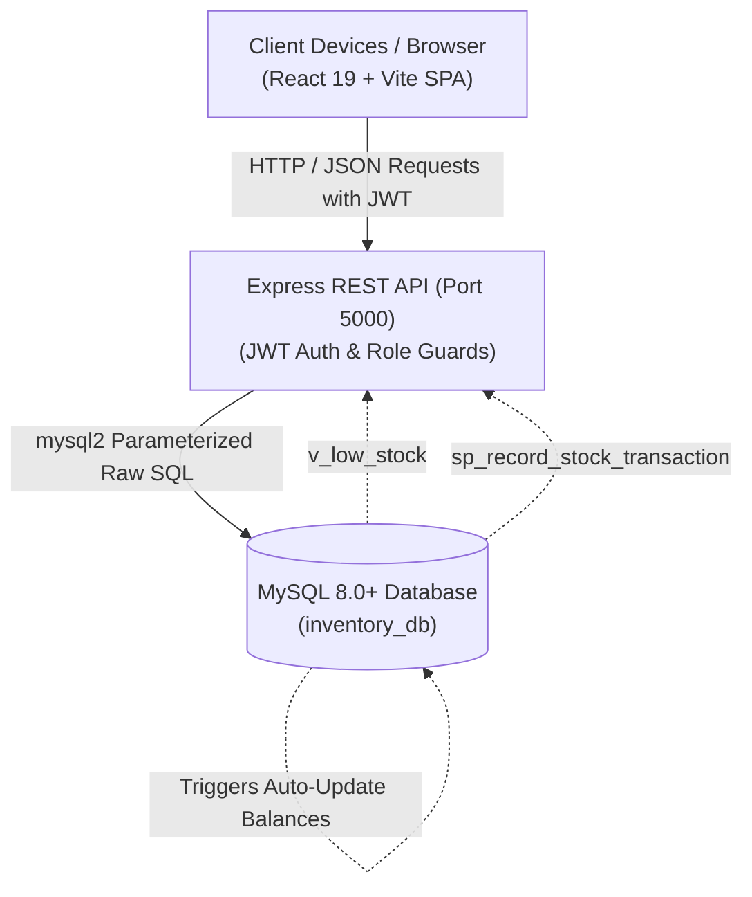
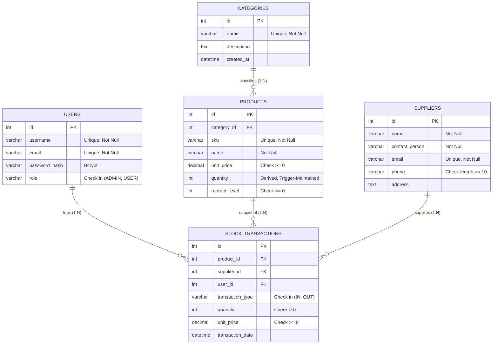

# 📦 Smart Inventory Management System (SIMS)

[](https://www.mysql.com/)
[](https://nodejs.org/)
[](https://expressjs.com/)
[](https://react.dev/)
[](https://vitejs.dev/)
[](https://opensource.org/licenses/MIT)

A robust, relational database-driven **Smart Inventory Management System** built with **MySQL 8**, **Node.js + Express** (using `mysql2` with raw SQL queries; no ORM), and **React with Vite** (Plain CSS).

Engineered to demonstrate database design principles: **3NF normalization**, **all 6 relational constraints**, **MySQL Views**, **Triggers** for automated stock balance maintenance and over-dispatch prevention, an **atomic Stored Procedure with row locking**, a **Stored Function** for inventory valuation, and **multi-table analytical queries with aggregation (`JOIN`, `GROUP BY`, `SUM`, `COUNT`, `AVG`)**.

---

## 🌟 Key Features

* **🔐 Role-Based Access Control (RBAC):**
  * **Admin:** Full CRUD on Products, Categories, and Suppliers; access to financial/procurement reports; record stock movements.
  * **Staff User:** Read-only access to catalogs and low-stock alerts; empowered to record stock inward/outward movements.
* **⚡ Database Trigger-Enforced Balances:**
  * `trg_after_stock_transaction_insert`: Automatically increments on-hand stock on inward arrivals (`IN`) and decrements on dispatches (`OUT`) inside the same database transaction ($O(1)$ fast lookups with zero application drift).
  * `trg_before_stock_transaction_insert`: Blocks outward dispatches exceeding on-hand stock with `SIGNAL SQLSTATE '45000'`.
* **🔒 Concurrency Control & Row-Level Locking:**
  * Stored Procedure `sp_record_stock_transaction` utilizes `SELECT ... FOR UPDATE` row locking to prevent race conditions during concurrent dispatches.
* **🚨 Real-Time Safety Stock Alerts:**
  * Powered by MySQL View `v_low_stock` to identify items at or below reorder threshold and calculate stock deficit dynamically.
* **📊 Business Intelligence & Reporting:**
  * Category Stock Valuation summary (`categories LEFT JOIN products ... COUNT(), SUM(), AVG(), GROUP BY`).
  * Supplier Procurement summary (`suppliers INNER JOIN stock_transactions ...`).
  * Executive dashboard KPI cards using Stored Function `fn_calculate_inventory_value()`.

---

## 🏗️ System Architecture



---

## 🗄️ Database Design & ER Diagram

The system resolves the $M:N$ relationship between Products and Suppliers using `stock_transactions` as an associative junction table with temporal transaction attributes.



---

## 🚀 Quick Start Guide

### 1. Prerequisites
- **Node.js** (v18 or higher)
- **MySQL Server 8.0+** running on port 3306

---

### 2. Database Setup

Clone the repository and import the database schema and seed data:

```bash
git clone https://github.com/Himanshu21482/Smart-Inventory-Management-System.git
cd Smart-Inventory-Management-System
```

Execute the SQL scripts in MySQL:

```cmd
:: Windows CMD
mysql -u root -p < database/schema.sql
mysql -u root -p < database/seed.sql
```

*(Or inside PowerShell:)*
```powershell
cmd.exe /c "mysql -u root -p < database/schema.sql"
cmd.exe /c "mysql -u root -p < database/seed.sql"
```

---

### 3. Backend Setup

```bash
cd backend
npm install
```

Configure `.env` (a template is available in `.env.example`):
```env
DB_HOST=localhost
DB_USER=root
DB_PASSWORD=
DB_NAME=inventory_db
DB_PORT=3306
PORT=5000
JWT_SECRET=supersecret_inventory_key_2026
JWT_EXPIRES_IN=24h
```

Seed initial user password hashes:
```bash
npm run seed:users
```

Start the backend server:
```bash
npm start
```
The backend API starts on **`http://localhost:5000`**.

---

### 4. Frontend Setup

In a new terminal window:

```bash
cd frontend
npm install
npm run dev
```

Open your browser to: **`http://localhost:5173`** (or **`http://localhost:5000`** if using unified mode).

---

## 🔑 Demo Login Accounts

The login screen features **one-click demo shortcuts** to fill credentials immediately:

| Role | Username | Password | Permissions |
| :--- | :--- | :--- | :--- |
| 👑 **Administrator** | `admin` | `admin123` | Full CRUD on Products, Categories, Suppliers; access to Analytics Reports; Stock movements. |
| 👤 **Staff User** | `staff_john` | `user123` | Read-only catalog views; Low stock views; Stock movement logging (IN/OUT). |

---

## 🧪 Automated Testing & Edge Cases

An automated test suite verifies all endpoints, database constraints, stored procedure outputs, trigger rejections, and role guards:

```bash
node test-e2e.js
```

### Verified Test Cases:
* [x] Admin authentication & JWT token generation
* [x] Staff user authentication & role restriction (blocks Admin-only routes with HTTP 403)
* [x] Product creation (initial stock initialized to 0)
* [x] Inward stock movement calls `sp_record_stock_transaction` and trigger automatically increments stock
* [x] Outward movement exceeding stock is rejected with `SIGNAL SQLSTATE '45000'` ("Insufficient stock")
* [x] Foreign key protection prevents deleting categories/suppliers currently linked to products or transactions
* [x] Dynamic search and filtering by SKU, name, category, and low-stock flag
* [x] Real-time query against MySQL View `v_low_stock`
* [x] Category valuation report calculation via `LEFT JOIN` + `GROUP BY` + aggregations
* [x] Supplier spend report calculation via `INNER JOIN` + `GROUP BY`
* [x] Gross inventory value calculation via Stored Function `fn_calculate_inventory_value()`

---

## 📡 REST API Summary

| Module | Method | Endpoint | Access | Description |
| :--- | :---: | :--- | :---: | :--- |
| **Auth** | `POST` | `/api/auth/login` | Public | Authenticates user; returns JWT token |
| **Auth** | `GET` | `/api/auth/me` | User / Admin | Retrieves current logged-in profile |
| **Products** | `GET` | `/api/products` | User / Admin | Dynamic search & category filter |
| **Products** | `GET` | `/api/products/:id` | User / Admin | Single product details |
| **Products** | `POST` | `/api/products` | Admin Only | Add product (initial stock = 0) |
| **Products** | `PUT` | `/api/products/:id` | Admin Only | Update product details |
| **Products** | `DELETE`| `/api/products/:id` | Admin Only | Delete product (guarded if referenced) |
| **Products** | `GET` | `/api/products/low-stock` | User / Admin | Queries MySQL View `v_low_stock` |
| **Categories**| `GET` | `/api/categories` | User / Admin | List categories with product counts |
| **Categories**| `POST` | `/api/categories` | Admin Only | Add new category |
| **Categories**| `PUT` | `/api/categories/:id` | Admin Only | Edit category |
| **Categories**| `DELETE`| `/api/categories/:id` | Admin Only | Delete category (guarded if products exist) |
| **Suppliers** | `GET` | `/api/suppliers` | User / Admin | List suppliers with shipment count |
| **Suppliers** | `POST` | `/api/suppliers` | Admin Only | Register new supplier |
| **Suppliers** | `PUT` | `/api/suppliers/:id` | Admin Only | Edit supplier details |
| **Suppliers** | `DELETE`| `/api/suppliers/:id` | Admin Only | Delete supplier |
| **Transactions**| `GET` | `/api/transactions` | User / Admin | Transaction audit ledger with joins |
| **Transactions**| `POST`| `/api/transactions` | User / Admin | **Calls Stored Procedure `sp_record_stock_transaction`** |
| **Reports** | `GET` | `/api/reports/category-summary` | Admin Only | Category valuation report |
| **Reports** | `GET` | `/api/reports/supplier-procurement`| Admin Only | Supplier procurement spend report |
| **Reports** | `GET` | `/api/reports/kpi-summary` | User / Admin | KPI cards (invokes `fn_calculate_inventory_value`) |

---

## 📚 Technical Documentation & Viva Preparation

Comprehensive documentation for academic evaluations is available in the [`/docs`](docs/) directory:

1. [**01 - Project Overview**](docs/01-project-overview.md): Problem statement, objectives, and module specifications.
2. [**02 - ER Diagram & Modeling**](docs/02-er-diagram.md): Entity attributes, cardinality, and $M:N$ resolution.
3. [**03 - Relational Schema & Normalization**](docs/03-relational-schema-and-normalization.md): Functional dependencies and formal 1NF, 2NF, and 3NF proofs.
4. [**04 - Database Schema DDL**](docs/04-schema.sql): Complete MySQL DDL with constraints, view, triggers, and procedures.
5. [**05 - Seed Data**](docs/05-seed-data.sql): Realistic baseline dataset (10+ records per table).
6. [**06 - Operational Queries**](docs/06-queries.md): SQL queries for search, stored procedures, and reports.
7. [**07 - REST API Specification**](docs/07-api-spec.md): Complete request/response JSON schemas.
8. [**08 - Frontend Specification**](docs/08-frontend-spec.md): Component hierarchy and validation rules.
9. [**09 - Mandatory Requirements Matrix**](docs/09-requirements-checklist.md): Traceability matrix of the 11 DBMS criteria.
10. [**10 - Implementation Roadmap**](docs/10-implementation-plan.md): Directory blueprint and build steps.
11. [**11 - DBMS Viva & Presentation Mastery Guide**](docs/11-dbms-viva-presentation-guide.md): Comprehensive viva preparation with **Top 25 rapid-fire questions and answers**.

---

## 📄 License
This project is open-source and available under the [MIT License](LICENSE).
