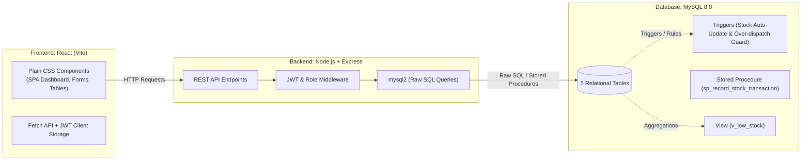

# 01 - Project Overview

## 1. Project Title
**Smart Inventory Management System (SIMS)**  
*Target Environment: Small-to-Medium Retail Shop / Warehouse*

---

## 2. Problem Statement
Small retail businesses and local warehouses frequently rely on manual registers, disconnected spreadsheets, or informal communication to track product stock. This approach leads to severe operational inefficiencies:
- **Frequent Stock-outs:** High-demand items run out of stock unnoticed because there is no automated reorder warning system.
- **Over-purchasing & Capital Lockup:** Inaccurate quantity records lead to duplicate purchasing, locking working capital in slow-moving items.
- **Inventory Discrepancies & Leakage:** Without transactional audit trails linking inward receipts to suppliers and outward dispatches to staff members, stock shrinkage cannot be traced.
- **Slow Valuation Reporting:** Calculating total inventory value or supplier-wise procurement spending requires hours of tedious spreadsheet reconciliation.

The **Smart Inventory Management System** solves these challenges by providing a relational database-backed web application that automates stock tracking, enforces transactional integrity at the database layer, and delivers instant inventory reports.

---

## 3. Project Objectives
1. **Automated Stock Balance Tracking:** Maintain consistent real-time item quantities updated automatically through database triggers whenever stock arrives (IN) or is dispatched (OUT).
2. **Defensive Data Integrity:** Enforce data validity directly in MySQL using primary/foreign keys, unique constraints, and check constraints (preventing negative inventory or invalid price figures).
3. **Role-Based Access Control (RBAC):** Provide distinct interfaces and privileges for Administrators (full configuration and CRUD) and Staff Users (read-only inventory lookups and transaction entry).
4. **Proactive Stock Monitoring:** Provide an instant alert view (`v_low_stock`) identifying items that have reached or fallen below their safety reorder threshold.
5. **Business Intelligence Reporting:** Utilize SQL multi-table joins, aggregation (`SUM`, `COUNT`, `AVG`), and grouping (`GROUP BY`) to generate category-level valuation summaries and supplier procurement performance metrics.

---

## 4. User Roles and Permissions

The system implements two distinct user roles:

| Privilege / Action | Admin (`ADMIN`) | Staff User (`USER`) |
| :--- | :---: | :---: |
| **System Login (JWT)** | Yes | Yes |
| **View Dashboard & KPI Summary** | Yes | Yes |
| **View Products, Categories, Suppliers** | Yes | Yes |
| **Search & Filter Inventory** | Yes | Yes |
| **View Low-Stock Alerts (`v_low_stock`)** | Yes | Yes |
| **Record Stock Transaction (IN / OUT)** | Yes | Yes |
| **View Transaction History Log** | Yes | Yes |
| **Create / Edit / Delete Products** | Yes | No (Read-only) |
| **Create / Edit / Delete Categories** | Yes | No (Read-only) |
| **Create / Edit / Delete Suppliers** | Yes | No (Read-only) |
| **Access Financial Valuation Reports** | Yes | No (Restricted) |

---

## 5. System Modules

### 5.1. Authentication & Security Module
- Secure JWT-based stateless authentication.
- Password encryption using salted `bcrypt` hashes.
- Role-based route guards in both backend Express middleware and frontend React components.

### 5.2. Category Management Module
- Group products into logical departments (e.g., Electronics, Audio, Accessories).
- Full CRUD operations with uniqueness checks on category names.

### 5.3. Supplier Management Module
- Central directory of vendors, distributors, and manufacturers.
- Captures contact person, corporate email, 10-digit phone number, and physical address.
- Full CRUD operations with foreign key safeguards (prevents accidental deletion of suppliers with active transaction history).

### 5.4. Product Catalog Module
- Complete product master table with SKU (Stock Keeping Unit), title, description, category mapping, unit price, current quantity on hand, and reorder alert thresholds.
- Dynamic search by keyword/SKU, category dropdown filter, and low-stock filter.
- Full CRUD operations restricted to Administrators.

### 5.5. Stock Transactions Module
- Records every inventory movement:
  - **Stock IN:** Goods received from suppliers (increases stock quantity).
  - **Stock OUT:** Goods sold, dispatched, or issued to retail floor (decreases stock quantity).
- Handled through a dedicated MySQL stored procedure (`sp_record_stock_transaction`).
- Enforces strict validation via triggers: disallows any `OUT` transaction exceeding the available stock balance.

### 5.6. Low-Stock Alert Module
- Backed by MySQL View `v_low_stock`.
- Dynamically computes stock deficit (`reorder_level - quantity`) and remaining value for items at or below reorder threshold.

### 5.7. Reporting & Analytics Module
- **Category Stock Valuation Report:** Aggregates product count, total on-hand quantity, average unit price, and total monetary inventory value per category.
- **Supplier Procurement Report:** Summarizes total quantity supplied, transaction count, and cumulative expenditure per vendor.

---

## 6. High-Level Architecture & Tech Stack

- **Database:** MySQL 8.0 (InnoDB storage engine, UTF-8 charset, strict SQL mode).
- **Backend:** Node.js (v18+) with Express.js, utilizing `mysql2` connection pooling with parameterized SQL (no ORM).
- **Frontend:** React (Vite) with plain CSS (clean responsive design, native HTML5 validation, no heavy component libraries).
