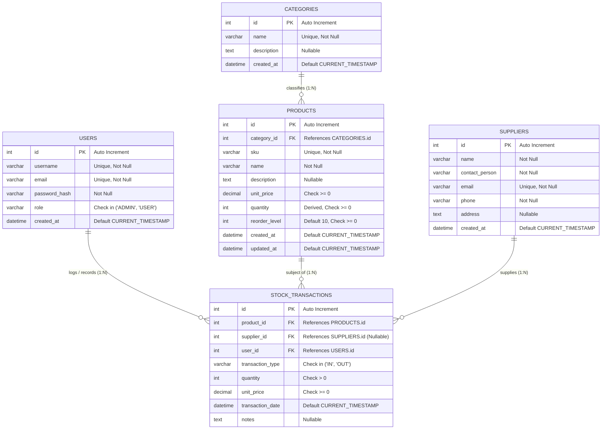

# 02 - Entity-Relationship (ER) Diagram

## 1. Conceptual ER Diagram (Mermaid)

The diagram below outlines the entities, attributes, primary/foreign keys, and relationships comprising the Inventory Management System.

---

## 2. Relationship Descriptions

| Primary Entity (1) | Foreign Entity (N) | Cardinality | Foreign Key Column | Plain-Language Explanation | Referential Action (ON DELETE / UPDATE) |
| :--- | :--- | :---: | :--- | :--- | :--- |
| **CATEGORIES** | **PRODUCTS** | `1 : N` | `products.category_id` | One product category contains zero or many products. Each product must belong to exactly one category. | `ON DELETE RESTRICT` `ON UPDATE CASCADE` |
| **PRODUCTS** | **STOCK_TRANSACTIONS** | `1 : N` | `stock_transactions.product_id` | A single product can have multiple historical stock transactions (inward receipts or outward dispatches). Every transaction must be linked to a valid product. | `ON DELETE RESTRICT` `ON UPDATE CASCADE` |
| **SUPPLIERS** | **STOCK_TRANSACTIONS** | `1 : N` | `stock_transactions.supplier_id` | A supplier can provide inventory across multiple inward stock transactions. For `OUT` transactions (customer sales or scrap), the supplier is optional (`NULL`). | `ON DELETE SET NULL` `ON UPDATE CASCADE` |
| **USERS** | **STOCK_TRANSACTIONS** | `1 : N` | `stock_transactions.user_id` | An authorized system user (Admin or Staff) records zero, one, or many stock transactions, providing an immutable audit trail of who authorized each movement. | `ON DELETE RESTRICT` `ON UPDATE CASCADE` |

---

## 3. Resolution of Many-to-Many (M:N) Relationship

In inventory management, **Products** and **Suppliers** have a conceptual Many-to-Many ($M:N$) business relationship:
- A single supplier provides many different products.
- A single product can be procured from multiple competing suppliers over time at different prices.

### How the $M:N$ is Resolved:
Directly linking `PRODUCTS` and `SUPPLIERS` with a standard static junction table (e.g., `product_suppliers`) only records static associations. In an operational warehouse, stock movements are **event-driven transactions** that occur over time.

Therefore, the associative entity **`STOCK_TRANSACTIONS`** functions as the dynamic junction table:
- It resolves the $M:N$ relationship between `PRODUCTS` and `SUPPLIERS`.
- It records essential temporal attributes for each inward procurement event:
  1. `quantity`: The exact quantity received in that batch.
  2. `unit_price`: The specific cost price paid at that point in time (protecting historical records from future product price changes).
  3. `transaction_date`: When the procurement occurred.
  4. `user_id`: The staff member who inspected and accepted the stock.

For outward dispatches (`OUT`), `supplier_id` is set to `NULL`, allowing the same unified table to capture both inward replenishment and outward customer dispatches without creating redundant structures.
