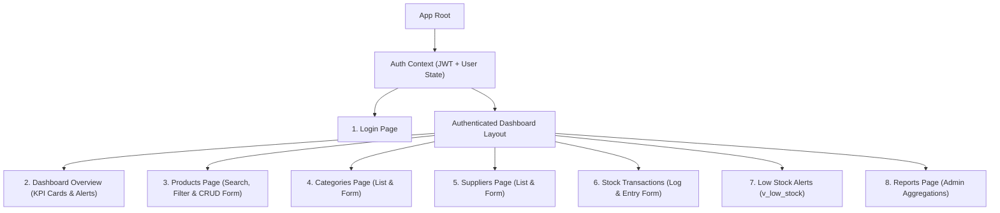

# 08 - Frontend Specification

## 1. UI Architecture & Styling
- **Framework:** React 18+ with Vite.
- **Styling Strategy:** Plain CSS with CSS Custom Properties (CSS variables) for a clean, responsive, dark/light modern interface without bulky UI libraries.
- **State & Routing:** Lightweight client-side state via React Hooks (`useState`, `useEffect`, `useContext`) and standard route transitions.
- **Role-Based UI Rendering:**
  - `ADMIN`: Full view; access to Create, Edit, Delete action buttons, Supplier/Category management, and Analytics Reports.
  - `USER`: Read-only views for Products, Categories, Suppliers, and Low-Stock alerts; fully enabled access to record Stock Transactions (IN/OUT).

---

## 2. Pages and Component Breakdown

---

### Page 1: Login Screen (`/login`)
- **Components:**
  - Login Card centered vertically and horizontally.
  - Form inputs: Username / Email, Password.
  - Role indicator preview / demo credential pills for fast evaluator testing (`admin` / `admin123` or `staff_john` / `user123`).
  - Error banner for invalid credentials.

---

### Page 2: Dashboard Overview (`/dashboard`)
- **Components:**
  - **KPI Metric Cards:**
    - Total Active Products
    - Total Gross Inventory Valuation (via `fn_calculate_inventory_value()`)
    - Active Low-Stock Items Count (clickable shortcut to Low Stock page)
    - Total Inward / Outward Transactions This Month
  - **Quick Low-Stock Alert Table:** First 5 urgent items requiring reorder.
  - **Recent Activity Feed:** Last 6 stock transactions with timestamp and user.

---

### Page 3: Products Catalog (`/products`)
- **Components:**
  - **Filter Bar:**
    - Live Search Input (filters dynamically by Name or SKU).
    - Category Dropdown selector.
    - "Low Stock Only" checkbox toggle.
    - Reset Filters button.
  - **Product Data Table:** Columns: SKU, Name, Category, Unit Price, Current Stock, Reorder Level, Status Badge (`In Stock` / `Low Stock`), Actions.
  - **Admin Action:** `+ Add Product` button triggers the modal dialog.
  - **Action Menu per Row (Admin only):** `Edit` and `Delete` buttons.

---

### Page 4: Categories Management (`/categories`)
- **Components:**
  - List of categories displaying Category Name, Description, and Associated Products Count.
  - `+ Add Category` modal form (Admin only).
  - Edit / Delete action triggers with safe deletion guards (cannot delete category with active products).

---

### Page 5: Suppliers Management (`/suppliers`)
- **Components:**
  - Suppliers directory table displaying Company Name, Contact Person, Email, Phone, Address, and Total Shipments Completed.
  - `+ Register Supplier` modal form (Admin only).
  - Edit / Delete action triggers.

---

### Page 6: Stock Transactions Ledger (`/transactions`)
- **Components:**
  - **Action Header:** `+ Record Stock Movement` button (open to both Admin and Staff).
  - **Transaction History Table:** Date/Time, Type (`IN` in Green / `OUT` in Amber), Product SKU & Name, Supplier (or "Retail Dispatch"), Quantity, Unit Cost, Total Value, Logged By Staff Member, Notes.
  - **Modal Form:** Form for recording inward shipment or outward dispatch.

---

### Page 7: Low Stock Alerts (`/low-stock`)
- **Components:**
  - Directly visualizes MySQL View `v_low_stock`.
  - Displays SKU, Name, Category, Current Quantity, Reorder Threshold, Deficit Quantity (units below safety stock), Unit Price, and Stock Value.
  - Quick Action button: `Restock Now` opens the Transaction modal pre-filled with the product and transaction type `IN`.

---

### Page 8: Business Intelligence Reports (`/reports` - Admin Only)
- **Components:**
  - **Tab 1: Category Stock Valuation Report:**
    - Summary Table: Category Name, Product Count, Total Units on Hand, Average Unit Price, Total Monetary Stock Value.
    - Summary metrics bar showing overall warehouse valuation.
  - **Tab 2: Supplier Procurement Report:**
    - Summary Table: Supplier Name, Contact Person, Total Inward Shipments, Cumulative Units Procured, Total Expenditure.

---

## 3. Comprehensive Form Field & Validation Specifications

Both client-side (React HTML5 + JavaScript) and backend (Express controllers) enforce identical validation rules to ensure total data integrity:

| Form Name | Field Name | Input Type | Validation Rules (Client & Server) | Error Message Displayed |
| :--- | :--- | :--- | :--- | :--- |
| **Login** | `username` | Text | Required; non-empty string; trimmed. | "Please enter your username or email." |
| | `password` | Password | Required; non-empty string. | "Please enter your password." |
| **Product Form** | `sku` | Text | Required; alphanumeric with hyphens; length 3-50; Unique. | "SKU is required (letters, numbers, hyphens only)." |
| | `name` | Text | Required; min 2 characters, max 150 characters. | "Product name must be between 2 and 150 characters." |
| | `category_id` | Select | Required; valid positive integer referencing existing category. | "Please select a valid category." |
| | `unit_price` | Number | Required; numeric; step `0.01`; value $\ge 0.00$. | "Price must be a valid non-negative number." |
| | `reorder_level`| Number | Required; integer; value $\ge 0$; default `10`. | "Reorder level must be a non-negative integer." |
| | `description` | Textarea | Optional; max 500 characters. | "Description cannot exceed 500 characters." |
| **Category Form**| `name` | Text | Required; min 2 characters, max 100 characters; Unique. | "Category name is required and must be unique." |
| | `description` | Textarea | Optional; max 500 characters. | "Description cannot exceed 500 characters." |
| **Supplier Form**| `name` | Text | Required; min 2 characters, max 150 characters. | "Supplier company name is required." |
| | `contact_person`| Text | Required; min 2 characters, max 100 characters. | "Contact person name is required." |
| | `email` | Email | Required; valid email format RFC 5322; Unique. | "Please provide a valid corporate email address." |
| | `phone` | Tel | Required; exactly 10 digits numeric (e.g. `9876543210`). | "Phone number must be a valid 10-digit number." |
| | `address` | Textarea | Optional; max 300 characters. | "Address cannot exceed 300 characters." |
| **Stock Movement**| `product_id` | Select | Required; valid product ID. | "Please select a product." |
| | `transaction_type`| Select | Required; must be either `'IN'` or `'OUT'`. | "Please select transaction type (IN or OUT)." |
| | `supplier_id` | Select | Required if type is `'IN'`; optional/disabled if `'OUT'`. | "Supplier is required for inward stock purchases." |
| | `quantity` | Number | Required; integer $> 0$; if `'OUT'`, must be $\le$ available stock. | "Quantity must be a positive integer within available stock." |
| | `unit_price` | Number | Required; numeric; value $\ge 0.00$. | "Unit cost/price cannot be negative." |
| | `notes` | Text | Optional; max 255 characters. | "Notes cannot exceed 255 characters." |

---

## 4. Client-Side Error & Alert Handling Strategy
1. **Inline Field Errors:** Highlighting inputs with red borders and displaying error text immediately beneath the corresponding field if validation fails before submission.
2. **Server-Side Trigger Errors:** If the MySQL database trigger rejects an outward transaction (due to insufficient stock), the backend returns HTTP 400 with the database trigger's message (`Business Rule Violation: Cannot dispatch OUT more items than current available stock`). The React client displays this error inside a clear, persistent warning banner on the modal form.
3. **Delete Confirmation Dialog:** Destructive actions (`Delete Product`, `Delete Supplier`) require explicit confirmation in a modal prompt, preventing accidental deletions.
