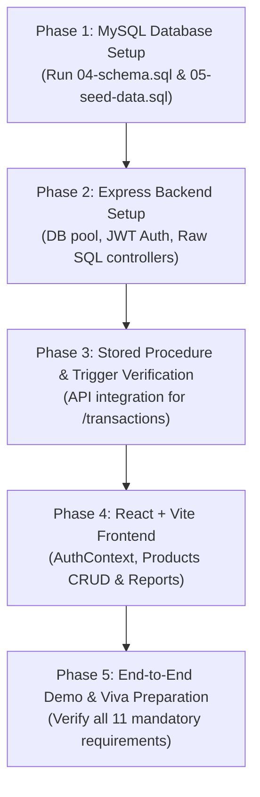

# 10 - Implementation Plan

This document outlines the directory structure and a fast, step-by-step path to implement the Smart Inventory Management System (DB $\rightarrow$ Backend $\rightarrow$ Frontend) for rapid demonstration and college project submission.

---

## 1. Project Directory Blueprint

```
c:\DBMS project\
├── docs/                                  # Technical specifications & documentation
│   ├── 01-project-overview.md
│   ├── 02-er-diagram.md
│   ├── 03-relational-schema-and-normalization.md
│   ├── 04-schema.sql
│   ├── 05-seed-data.sql
│   ├── 06-queries.md
│   ├── 07-api-spec.md
│   ├── 08-frontend-spec.md
│   ├── 09-requirements-checklist.md
│   └── 10-implementation-plan.md
│
├── backend/                               # Node.js + Express REST API (Raw mysql2)
│   ├── config/
│   │   └── db.js                          # mysql2 connection pool configuration
│   ├── middleware/
│   │   ├── auth.js                        # JWT validation & role authorization guards
│   │   └── errorHandler.js                # Global error and SQL exception handler
│   ├── controllers/
│   │   ├── authController.js              # Login, token generation & user profile
│   │   ├── categoryController.js          # Categories CRUD
│   │   ├── supplierController.js          # Suppliers CRUD
│   │   ├── productController.js           # Products CRUD, search & low-stock view
│   │   ├── transactionController.js       # Calls sp_record_stock_transaction
│   │   └── reportController.js            # Category valuation & supplier reports
│   ├── routes/
│   │   ├── authRoutes.js
│   │   ├── categoryRoutes.js
│   │   ├── supplierRoutes.js
│   │   ├── productRoutes.js
│   │   ├── transactionRoutes.js
│   │   └── reportRoutes.js
│   ├── .env.example                       # DB credentials & JWT secret template
│   ├── package.json
│   └── server.js                          # Express app entry point
│
└── frontend/                              # React Single Page App (Vite + Plain CSS)
    ├── index.html
    ├── package.json
    ├── vite.config.js
    └── src/
        ├── api/
        │   └── client.js                  # Central fetch wrapper with Bearer token
        ├── context/
        │   └── AuthContext.jsx            # Auth state (user, token, role, login/logout)
        ├── components/
        │   ├── Navbar.jsx                 # Top navigation & user role pill
        │   ├── Modal.jsx                  # Reusable modal container for forms
        │   ├── KPICard.jsx                # Metric cards for Dashboard & Reports
        │   └── DataTable.jsx              # Reusable table with status badges
        ├── pages/
        │   ├── LoginPage.jsx              # Login screen with quick credential pills
        │   ├── DashboardPage.jsx          # KPI metrics, low-stock alerts, recent tx
        │   ├── ProductsPage.jsx           # Catalog, multi-filter search & CRUD modal
        │   ├── CategoriesPage.jsx         # Category directory & CRUD modal
        │   ├── SuppliersPage.jsx          # Supplier directory & CRUD modal
        │   ├── TransactionsPage.jsx       # Transaction ledger & movement modal
        │   ├── LowStockPage.jsx           # Dedicated view for v_low_stock items
        │   └── ReportsPage.jsx            # Category valuation & supplier procurement
        ├── styles/
        │   └── main.css                   # Responsive plain CSS styles & themes
        ├── App.jsx                        # Layout & route switcher
        └── main.jsx                       # React entry point
```

---

## 2. Step-by-Step Implementation Roadmap



---

### Phase 1: Database Setup & Verification (Estimated time: 5-10 mins)
1. **Initialize MySQL Instance:**
   - Log into MySQL: `mysql -u root -p`.
2. **Execute Schema:**
   - Run `SOURCE c:/DBMS project/docs/04-schema.sql;` to create the database, tables, constraints, view, triggers, and stored procedure.
3. **Seed Initial Data:**
   - Run `SOURCE c:/DBMS project/docs/05-seed-data.sql;` to populate 10+ records across all tables and fire the trigger to establish initial product quantities.
4. **Smoke-Test Database Objects:**
   - Verify view: `SELECT * FROM v_low_stock;`
   - Test stored procedure: `CALL sp_record_stock_transaction(1, NULL, 1, 'OUT', 1, 650.00, 'Test', @id, @qty);`
   - Verify trigger defense: Try dispatching 9999 units to verify SQLSTATE 45000 is triggered.

---

### Phase 2: Node.js Backend Implementation (Estimated time: 25-30 mins)
1. **Scaffold Backend Project:**
   ```bash
   cd "c:\DBMS project"
   mkdir backend && cd backend
   npm init -y
   npm install express mysql2 dotenv cors bcryptjs jsonwebtoken
   ```
2. **Setup Database Pool (`config/db.js`):**
   - Configure `mysql2/promise` connection pool with environment variables.
3. **Implement Authentication (`authController.js` & `auth.js`):**
   - Login endpoint returning JWT containing `id`, `username`, and `role`.
   - Middleware to verify JWT and restrict Admin-only routes.
4. **Implement CRUD Controllers:**
   - `categoryController.js`, `supplierController.js`, and `productController.js` with raw SQL queries.
5. **Implement Transaction Controller (`transactionController.js`):**
   - Execute stored procedure `sp_record_stock_transaction` via `connection.query('CALL sp_record_stock_transaction(...)')`.
   - Forward MySQL trigger errors (`SQLSTATE 45000`) cleanly as HTTP 400 JSON errors.
6. **Implement Reports Controller (`reportController.js`):**
   - Endpoints for Category Stock Valuation and Supplier Procurement summaries.

---

### Phase 3: React Frontend Implementation (Estimated time: 30-35 mins)
1. **Scaffold Vite React App:**
   ```bash
   cd "c:\DBMS project"
   npm create vite@latest frontend -- --template react
   cd frontend
   npm install
   ```
2. **Configure Styling & Assets (`styles/main.css`):**
   - Clean, lightweight responsive CSS layout (sidebar, grid cards, data tables, modals, badges).
3. **Setup Auth Context (`context/AuthContext.jsx`):**
   - Manage JWT token in `localStorage`, decode role, and provide `login()` / `logout()` methods.
4. **Build Core Views:**
   - `LoginPage.jsx`: Easy 1-click test credentials for Admin and Staff.
   - `ProductsPage.jsx`: Search input, category dropdown, low-stock toggle, and Admin CRUD modal.
   - `TransactionsPage.jsx`: Stock ledger and "Record Movement" modal calling the backend procedure.
   - `LowStockPage.jsx`: Alert table fed directly by `v_low_stock`.
   - `ReportsPage.jsx`: Valuation and procurement analytics tables.

---

### Phase 4: Verification & College Demo Walkthrough (Estimated time: 10 mins)
1. **Login as Admin:**
   - Demonstrate adding a new product, editing a price, and viewing the reports.
2. **Trigger Demonstration:**
   - Open Stock Transactions $\rightarrow$ Record an `OUT` transaction larger than current quantity $\rightarrow$ show the modal displaying the trigger rejection message.
   - Record a valid `IN` transaction $\rightarrow$ verify that product quantity on the Products page automatically increased without manual edits.
3. **View Demonstration:**
   - Open Low Stock page $\rightarrow$ show real-time items needing replenishment from `v_low_stock`.
4. **Report Demonstration:**
   - Open Reports page $\rightarrow$ show multi-table `JOIN` with `SUM`, `COUNT`, `AVG`, and `GROUP BY`.
5. **Role-Based Security Demonstration:**
   - Logout and log in as normal user `staff_john`.
   - Show that Create/Edit/Delete buttons are hidden/disabled and Reports access is blocked, while transaction recording remains available.

---

## 3. Fastest Path to a Working Prototype (Summary)
To achieve a live, demonstrable system in minimum time:
1. Run `04-schema.sql` and `05-seed-data.sql` in MySQL (**5 mins**).
2. Wire up Express with `mysql2` and create the API routes matching `07-api-spec.md` (**25 mins**).
3. Mount the React UI with `AuthContext` and the Products + Transactions views (**30 mins**).
4. **Total Elapsed Time: ~60 minutes to complete, working DBMS project demo.**
