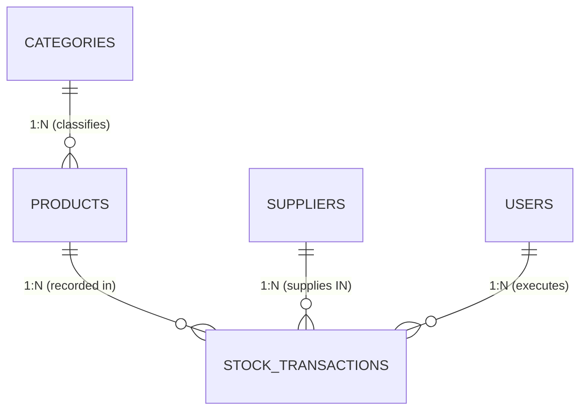

# DBMS Viva & Presentation Mastery Guide
**Project:** Smart Inventory Management System (SIMS)  
**Database Engine:** MySQL 8.0 / 8.4 (InnoDB Storage Engine)  
**Target Audience:** Viva Examiners, Professors, and Project Evaluators

---

## Table of Contents
1. [Core DBMS Architecture & Concepts](#1-core-dbms-architecture--concepts)
2. [Relational Keys & Constraints](#2-relational-keys--constraints)
3. [ER Modeling & Resolving Many-to-Many Relationships](#3-er-modeling--resolving-many-to-many-relationships)
4. [Normalization (1NF, 2NF, 3NF) & The Quantity Denormalization](#4-normalization-1nf-2nf-3nf--the-quantity-denormalization)
5. [Views (Virtual Tables)](#5-views-virtual-tables)
6. [Stored Procedures vs. Stored Functions](#6-stored-procedures-vs-stored-functions)
7. [Database Triggers & Business Rule Defense](#7-database-triggers--business-rule-defense)
8. [Transactions & ACID Properties](#8-transactions--acid-properties)
9. [Concurrency Control & Row-Level Locking](#9-concurrency-control--row-level-locking)
10. [Indexing & Query Optimization](#10-indexing--query-optimization)
11. [SQL Joins, Aggregation & Grouping](#11-sql-joins-aggregation--grouping)
12. [Top 25 Rapid-Fire Viva Questions & Rehearsed Answers](#12-top-25-rapid-fire-viva-questions--rehearsed-answers)

---

## 1. Core DBMS Architecture & Concepts

### 1.1. What is a DBMS, and why did we choose MySQL?
* **DBMS (Database Management System):** Software that interacts with end users, applications, and the database itself to capture and analyze data while ensuring security, data integrity, and ACID compliance.
* **Why MySQL 8?:**
  1. **Relational Model (RDBMS):** Inventory requires structured relationships between products, categories, suppliers, and transaction movements.
  2. **InnoDB Engine:** Default storage engine in MySQL providing row-level locking, foreign key constraints, and crash recovery (ACID compliance).
  3. **Rich Procedural Engine:** Native support for Views, Stored Procedures, Functions, and Triggers directly on the server.

### 1.2. The Three-Schema Architecture (ANSI/SPARC) in this Project
```
+------------------------------------------------------------------+
| External Level (User Views)                                      |
|  - Admin Dashboard, Cashier Transaction Form, Low-Stock Alert UI |
+------------------------------------------------------------------+
                                 ▲
                                 │ Logical Data Independence
                                 ▼
+------------------------------------------------------------------+
| Conceptual Level (Logical Schema)                                |
|  - 5 Tables (users, categories, suppliers, products, tx)        |
|  - Relationships, Keys, CHECK constraints, Triggers, Views       |
+------------------------------------------------------------------+
                                 ▲
                                 │ Physical Data Independence
                                 ▼
+------------------------------------------------------------------+
| Internal Level (Physical Schema)                                 |
|  - InnoDB tablespaces (*.ibd files), B+ Tree Primary Indexes,     |
|  - Redo logs, Undo logs, Doublewrite buffer                      |
+------------------------------------------------------------------+
```

---

## 2. Relational Keys & Constraints

Examiners love asking about keys. Here is how each type of key is implemented in our schema:

### 2.1. Key Definitions & Project Examples

| Key Type | Academic Definition | Implementation in Our Project |
| :--- | :--- | :--- |
| **Super Key** | Any set of attributes that uniquely identifies a tuple. | `{id}`, `{id, name}`, `{sku, unit_price}` |
| **Candidate Key** | A minimal Super Key (no redundant attributes). | In `products`: `{id}` and `{sku}` are candidate keys. In `users`: `{id}`, `{username}`, `{email}`. |
| **Primary Key (PK)** | The chosen candidate key used to uniquely address rows physically. | `id INT AUTO_INCREMENT PRIMARY KEY` on all 5 tables. |
| **Alternate Key** | Candidate keys not chosen as the Primary Key. | `sku` in `products`, `email` in `suppliers`, `username` in `users`. |
| **Foreign Key (FK)** | An attribute that creates a referential link to the PK of another table. | `products.category_id` references `categories(id)`. |
| **Surrogate Key** | An artificial/system-generated key with no business meaning. | `id INT AUTO_INCREMENT` (ensures fast integer index lookups). |
| **Natural Key** | A key formed of attributes that exist in the real world. | `sku` (`SKU-LAP-001`) or `email`. |

---

### 2.2. The 6 Constraints Demonstrated in Code
A constraint is a database rule enforced on columns to prevent invalid data insertion:

```sql
-- Located in: database/schema.sql
CREATE TABLE products (
    id INT AUTO_INCREMENT PRIMARY KEY,                  -- 1. PRIMARY KEY
    category_id INT NOT NULL,                           -- 2. NOT NULL
    sku VARCHAR(50) NOT NULL UNIQUE,                    -- 3. UNIQUE
    name VARCHAR(150) NOT NULL,
    unit_price DECIMAL(10, 2) NOT NULL DEFAULT 0.00,    -- 4. DEFAULT
    quantity INT NOT NULL DEFAULT 0,
    reorder_level INT NOT NULL DEFAULT 10,
    created_at DATETIME NOT NULL DEFAULT CURRENT_TIMESTAMP,
    
    -- 5. FOREIGN KEY with Referential Integrity Actions
    CONSTRAINT fk_products_category 
        FOREIGN KEY (category_id) REFERENCES categories (id)
        ON DELETE RESTRICT 
        ON UPDATE CASCADE,

    -- 6. CHECK Constraints (Domain Integrity)
    CONSTRAINT chk_products_unit_price CHECK (unit_price >= 0.00),
    CONSTRAINT chk_products_quantity CHECK (quantity >= 0),
    CONSTRAINT chk_products_reorder_level CHECK (reorder_level >= 0)
);
```

### 2.3. Referential Actions: `RESTRICT` vs. `CASCADE` vs. `SET NULL`
* **`ON DELETE RESTRICT` (Used on `products.category_id` and `stock_transactions.product_id`):**  
  Prevents deleting a category if products exist in it, or deleting a product if transaction history exists. Protects audit data.
* **`ON UPDATE CASCADE`:**  
  If a category's `id` changes, the child products automatically update to the new `id`.
* **`ON DELETE SET NULL` (Used on `stock_transactions.supplier_id`):**  
  If a supplier company closes down and is deleted, their past outward shipments remain in the audit ledger with `supplier_id = NULL` rather than corrupting transaction history.

---

## 3. ER Modeling & Resolving Many-to-Many Relationships



### Viva Question: "How did you handle the Many-to-Many relationship between Products and Suppliers?"
* **Theoretical Answer:**  
  In business reality, a supplier supplies many products, and a product can be purchased from different suppliers over time ($M:N$). In relational algebra, an $M:N$ relationship cannot be implemented directly with a single foreign key without causing multi-valued attributes or repeating groups.
* **Our Project Solution:**  
  We resolved the $M:N$ into two $1:N$ relationships using **`stock_transactions`** as an **associative entity (junction ledger)**:
  * `suppliers` $(1) \rightarrow (N)$ `stock_transactions`
  * `products` $(1) \rightarrow (N)$ `stock_transactions`
* **Why not a static `product_suppliers` table?:**  
  A static table only records *who can supply what*. An inventory system requires **temporal event tracking** (recording the purchase date, unit price paid at that time, quantity received, and staff member who verified the shipment). `stock_transactions` captures this historical audit trail.

---

## 4. Normalization (1NF, 2NF, 3NF) & The Quantity Denormalization

### 4.1. What are Anomalies?
Without normalization, databases suffer from three major anomalies:
1. **Insertion Anomaly:** Cannot record a new category without creating a dummy product if categories and products are in the same table.
2. **Update Anomaly:** If a supplier's phone number changes, we would have to update thousands of duplicate rows; missing one causes data inconsistency.
3. **Deletion Anomaly:** Deleting the last product of a brand would inadvertently erase the supplier's contact details.

---

### 4.2. Step-by-Step Normalization Proof

#### First Normal Form (1NF)
* **Rule:** Every column must hold atomic (indivisible) scalar values. No arrays, JSON lists, or comma-separated values.
* **Proof:** In our database, addresses, telephone numbers, SKUs, and prices are single scalar values. Transactions are stored as distinct rows, not comma-separated lists in `products`.

#### Second Normal Form (2NF)
* **Rule:** Table must be in 1NF and have **no partial functional dependencies** (no non-prime attribute can depend on a subset of a composite candidate key).
* **Proof:**  
  $$\forall X \rightarrow Y, \quad |X| = 1$$
  Every table in our system uses a single-column surrogate primary key (`id`). Because there are **no composite candidate keys**, a partial key dependency is mathematically impossible. Therefore, the schema is automatically in 2NF.

#### Third Normal Form (3NF)
* **Rule:** Table must be in 2NF and have **no transitive dependencies** ($X \rightarrow Z \rightarrow Y$). Non-prime attributes must depend only on the primary key, the whole key, and nothing but the key.
* **Proof:**  
  In `products`, we do not store `category_name`. We only store `category_id`. If `category_name` were stored in `products`, we would have:
  $$\text{product\_id} \rightarrow \text{category\_id} \rightarrow \text{category\_name}$$
  By extracting `categories` into its own table, transitive dependency is eliminated.

---

### 4.3. The Classic Examiner Question: "Why is `products.quantity` stored if it is a derived attribute?"

In strict relational theory, `quantity` is derived:
$$\text{quantity} = \sum (\text{IN transactions}) - \sum (\text{OUT transactions})$$
Strict 3NF theory dictates dropping `products.quantity` and computing it dynamically on every query.

**Why our engineering choice is superior (and how to explain it):**
1. **$O(1)$ vs. $O(N)$ Computational Complexity:**  
   In a warehouse with 500,000 transaction records, computing the sum of transactions for every product on the catalog, search bar, and dashboard would require a full table scan and aggregation over 500,000 rows on every single page refresh ($O(N)$ time). Storing `products.quantity` allows an instant $O(1)$ indexed lookup.
2. **Instant Low-Stock Evaluation:**  
   Querying `WHERE quantity <= reorder_level` is a simple indexed range scan. Without the column, it would require a `HAVING SUM(...) <= reorder_level` aggregate scan over every transaction ever logged.
3. **Trigger-Guaranteed Consistency (No Drift):**  
   Denormalization usually introduces the risk of human or application error. In our project, **application code is forbidden from updating `products.quantity` directly**. An automated MySQL `AFTER INSERT` trigger atomically adjusts the stock balance inside the same database transaction. If the transaction rolls back, the quantity adjustment rolls back too.

---

## 5. Views (Virtual Tables)

### 5.1. Definition
A **View** is a saved SQL query stored in the database dictionary. It does not store physical data itself (unless it is a materialized view); it dynamically runs the underlying `SELECT` statement whenever referenced.

### 5.2. Implementation in Our Project: `v_low_stock`
Located in [`database/schema.sql`](file:///c:/DBMS%20project/database/schema.sql#L144-L166):
```sql
CREATE OR REPLACE VIEW v_low_stock AS
SELECT
    p.id AS product_id,
    p.sku,
    p.name AS product_name,
    c.id AS category_id,
    c.name AS category_name,
    p.quantity AS current_quantity,
    p.reorder_level,
    (p.reorder_level - p.quantity) AS deficit_quantity,  -- Derived business calculation
    p.unit_price,
    (p.quantity * p.unit_price) AS current_stock_value,  -- Derived stock valuation
    p.updated_at AS last_updated
FROM products p
INNER JOIN categories c ON p.category_id = c.id
WHERE p.quantity <= p.reorder_level;
```

### 5.3. Why use a View here?
1. **Abstraction & Security:** The application queries `SELECT * FROM v_low_stock` without needing to know the complex inner join or deficit calculation formula.
2. **Encapsulation:** If the criteria for "low stock" changes in the future (e.g. `quantity <= reorder_level * 1.2`), we update only the view definition in MySQL. Zero changes are needed in the backend or frontend code!

---

## 6. Stored Procedures vs. Stored Functions

Examiners frequently ask to compare procedures and functions:

| Feature | Stored Procedure (`sp_record_stock_transaction`) | Stored Function (`fn_calculate_inventory_value`) |
| :--- | :--- | :--- |
| **Purpose** | Executes business logic, modifications, and transactions. | Performs a calculation and returns a single value. |
| **Return Value** | Does not use `RETURN`; uses `OUT` parameters or result sets. | **Must** return a single value via `RETURN <type>`. |
| **Usage in SQL** | Invoked using `CALL procedure_name(...)`. | Invoked directly inside SQL queries (`SELECT fn(...)`). |
| **DML Statements** | Can perform `INSERT`, `UPDATE`, `DELETE`, `START TRANSACTION`. | Strictly intended for read operations (`READS SQL DATA`). |

### 6.1. Our Stored Procedure: `sp_record_stock_transaction`
Located in [`database/schema.sql`](file:///c:/DBMS%20project/database/schema.sql#L250-L368):
* Takes `IN` parameters (`product_id`, `supplier_id`, `user_id`, `transaction_type`, `quantity`, `unit_price`, `notes`).
* Validates foreign key existence.
* Locks the product row using `SELECT ... FOR UPDATE` (concurrency control).
* Inserts into `stock_transactions` (firing the trigger).
* Returns `OUT` parameters (`p_transaction_id`, `p_updated_quantity`).
* Features an `EXIT HANDLER FOR SQLEXCEPTION` with automated `ROLLBACK`.

### 6.2. Our Stored Function: `fn_calculate_inventory_value`
Located in [`database/schema.sql`](file:///c:/DBMS%20project/database/schema.sql#L168-L188):
```sql
CREATE FUNCTION fn_calculate_inventory_value()
RETURNS DECIMAL(12, 2)
DETERMINISTIC
READS SQL DATA
BEGIN
    DECLARE total_val DECIMAL(12, 2) DEFAULT 0.00;
    SELECT COALESCE(SUM(quantity * unit_price), 0.00) INTO total_val FROM products;
    RETURN total_val;
END //
```
Used on the dashboard to calculate the gross valuation of all warehouse assets in one call.

---

## 7. Database Triggers & Business Rule Defense

A trigger is procedural SQL code automatically executed (fired) by the database engine in response to a specific DML event (`INSERT`, `UPDATE`, `DELETE`) on a specified table.

### 7.1. Trigger 1: `trg_before_stock_transaction_insert` (Validation Guard)
* **Timing:** `BEFORE INSERT ON stock_transactions`
* **Purpose:** Inspects `NEW.quantity` and `NEW.transaction_type`. If an outward dispatch (`OUT`) is attempted that exceeds the available product stock, it halts the operation by throwing an exception:
  ```sql
  IF NEW.transaction_type = 'OUT' THEN
      IF v_available_qty < NEW.quantity THEN
          SIGNAL SQLSTATE '45000'
          SET MESSAGE_TEXT = 'Business Rule Violation: Cannot dispatch OUT more items than current available stock.';
      END IF;
  END IF;
  ```
* **Why `SQLSTATE '45000'`?:** `45000` is the standard ANSI SQL code reserved for user-defined unhandled exceptions.

### 7.2. Trigger 2: `trg_after_stock_transaction_insert` (Automated State Maintenance)
* **Timing:** `AFTER INSERT ON stock_transactions`
* **Purpose:** Automatically increments or decrements `products.quantity`:
  ```sql
  IF NEW.transaction_type = 'IN' THEN
      UPDATE products SET quantity = quantity + NEW.quantity WHERE id = NEW.product_id;
  ELSEIF NEW.transaction_type = 'OUT' THEN
      UPDATE products SET quantity = quantity - NEW.quantity WHERE id = NEW.product_id;
  END IF;
  ```

### 7.3. What are `NEW` and `OLD` in Triggers?
* **`NEW`:** A pseudo-record representing the incoming row being inserted or updated.
* **`OLD`:** A pseudo-record representing the existing row before an update or delete.
* *In our `AFTER INSERT` trigger, `NEW.quantity` gives the quantity of the newly recorded movement.*

---

## 8. Transactions & ACID Properties

A transaction is a single logical unit of work consisting of one or more database operations.

```
       START TRANSACTION
              │
              ▼
   Step 1: Check available stock
              │
              ▼
   Step 2: Insert into stock_transactions
              │
              ▼
   Step 3: Trigger updates products.quantity
              │
      ┌───────┴───────┐
      ▼               ▼
 (If all OK)     (If any error)
    COMMIT          ROLLBACK
```

### The ACID Properties in this Project:

1. **Atomicity (All-or-Nothing):**  
   If recording a stock movement succeeds, both the ledger record in `stock_transactions` and the updated balance in `products` are written. If MySQL runs out of disk space, or a constraint is violated, the `SQLEXCEPTION` handler executes `ROLLBACK`, leaving zero partial data.
2. **Consistency (Integrity Constraints):**  
   The database never enters an illegal state. `CHECK (quantity >= 0)` and `CHECK (unit_price >= 0.00)` ensure that negative inventory or corrupted prices can never be written.
3. **Isolation (Concurrent Independence):**  
   Multiple users issuing dispatches simultaneously do not overwrite each other. Guaranteed via InnoDB's default Repeatable Read isolation level and row-level locking.
4. **Durability (Permanence):**  
   Once `COMMIT` executes, the transaction is flushed to the InnoDB Write-Ahead Redo Log (`ib_logfile0`). Even if the server suffers a sudden power loss, MySQL re-applies committed transactions upon restart during crash recovery.

---

## 9. Concurrency Control & Row-Level Locking

### Viva Question: "What happens if two cashiers sell the last remaining unit of an item at the exact same millisecond?"
This is the classic **Race Condition / Lost Update problem**.

```
Time    Cashier A (Stock = 1)                 Cashier B (Stock = 1)
 t1     Reads stock = 1                       Reads stock = 1
 t2     Dispatches 1 (Stock becomes 0)        Dispatches 1 (Stock becomes -1) -> ERROR!
```

### How we solved it in `sp_record_stock_transaction`:
We implemented **Pessimistic Concurrency Control** using **Row-Level Locking**:
```sql
SELECT quantity INTO v_current_quantity
FROM products
WHERE id = p_product_id
FOR UPDATE;
```
* **How `FOR UPDATE` works:**  
  When Cashier A selects the product `FOR UPDATE`, InnoDB places an exclusive write lock ($X$-lock) on that specific product row.
* If Cashier B tries to query or dispatch that same product, Cashier B's thread is **suspended and placed in a wait queue** until Cashier A completes (`COMMIT`).
* Cashier B then reads the updated stock (`0`), and the trigger/procedure rejects the second order immediately with `Insufficient stock`.

---

## 10. Indexing & Query Optimization

### 10.1. What is an Index?
An auxiliary data structure (specifically a **$B+$ Tree** in InnoDB) that allows the database engine to find specific rows in logarithmic time ($O(\log N)$) without scanning the entire table ($O(N)$).

### 10.2. Indexes Created in Our Project:
```sql
CREATE INDEX idx_products_category ON products(category_id);
CREATE INDEX idx_products_quantity ON products(quantity);
CREATE INDEX idx_transactions_product ON stock_transactions(product_id);
CREATE INDEX idx_transactions_date ON stock_transactions(transaction_date);
```

### 10.3. Clustered vs. Non-Clustered Indexes
* **Clustered Index (Primary Key):** In InnoDB, the table data is physically sorted and stored directly in the leaves of the Primary Key $B+$ Tree. There can only be **one** clustered index per table (`id`).
* **Secondary (Non-Clustered) Index:** Auxiliary trees storing the indexed column value and a pointer back to the primary key. For example, `idx_products_category` speeds up filtering products by category without scanning unrelated products.

---

## 11. SQL Joins, Aggregation & Grouping

### 11.1. Joins Used in the Project
* **`INNER JOIN`:** Returns rows when there is a match in both tables.  
  *Example:* Joining `products` and `categories` where every product must have a valid category.
* **`LEFT JOIN` (Outer Join):** Returns all rows from the left table, and matched rows from the right table (filling with `NULL` if no match exists).  
  *Example:* `categories LEFT JOIN products` ensures categories with 0 products still appear on our Valuation Report.

---

### 11.2. The Analytical Report Query Breakdown
Located in [`backend/routes/reportRoutes.js`](file:///c:/DBMS%20project/backend/routes/reportRoutes.js):

```sql
SELECT 
    c.id AS category_id,
    c.name AS category_name,
    COUNT(p.id) AS total_product_count,                       -- Aggregate: Total SKUs
    COALESCE(SUM(p.quantity), 0) AS total_stock_quantity,     -- Aggregate: Sum of units
    COALESCE(AVG(p.unit_price), 0.00) AS avg_product_price,   -- Aggregate: Mean price
    COALESCE(SUM(p.quantity * p.unit_price), 0.00) AS total_stock_value -- Expression Aggregate
FROM categories c
LEFT JOIN products p ON c.id = p.category_id
GROUP BY c.id, c.name                                         -- Grouping columns
ORDER BY total_stock_value DESC;
```

### Viva Question: "What is the difference between `WHERE` and `HAVING`?"
* **`WHERE`:** Filters rows **before** any aggregation takes place (operates on individual records).
* **`HAVING`:** Filters groups **after** aggregation has been calculated (operates on aggregate values like `HAVING SUM(p.quantity) > 50`).

---

## 12. Top 25 Rapid-Fire Viva Questions & Rehearsed Answers

### Q1: What is the primary difference between DDL, DML, and DCL?
**Answer:** DDL (Data Definition Language like `CREATE`, `ALTER`, `DROP`) defines the structure/schema. DML (Data Manipulation Language like `SELECT`, `INSERT`, `UPDATE`, `DELETE`) manages the data inside the schema. DCL (Data Control Language like `GRANT`, `REVOKE`) manages permissions.

### Q2: Why did you use `DECIMAL(10, 2)` instead of `FLOAT` or `DOUBLE` for prices?
**Answer:** `FLOAT` and `DOUBLE` use binary floating-point representation, which causes inexact rounding errors (e.g. $0.1 + 0.2 = 0.30000000000000004$). `DECIMAL(10, 2)` stores exact fixed-point numbers, which is mandatory for financial and monetary calculations.

### Q3: What is the role of `COALESCE()` in your queries?
**Answer:** `COALESCE(value, fallback)` returns the first non-null expression in its argument list. When a category has zero products, `SUM(p.quantity)` evaluates to `NULL`. Wrapping it in `COALESCE(SUM(...), 0)` ensures our frontend receives a clean `0` instead of `null`.

### Q4: What is referential integrity?
**Answer:** A relational property ensuring that a foreign key value in a child table must always correspond to an existing primary key value in the parent table, preventing orphan records.

### Q5: Can a primary key contain `NULL` values?
**Answer:** No. Entity integrity dictates that a Primary Key must be unique and strictly `NOT NULL` so every row can be unambiguously identified.

### Q6: What is a surrogate key, and why did you use it?
**Answer:** A surrogate key (like our `id AUTO_INCREMENT`) is an artificial identifier with no real-world business meaning. We use it because integers are fixed-width (4 bytes), highly compact, fast to compare in $B+$ Trees, and immune to real-world business changes (unlike a phone number or company name).

### Q7: What is the difference between `CHAR` and `VARCHAR`?
**Answer:** `CHAR(n)` is fixed-length and pads spaces to always take $n$ characters of storage. `VARCHAR(n)` is variable-length and consumes only the actual characters stored plus 1 or 2 bytes of length prefix, saving disk space.

### Q8: What is the purpose of `DELIMITER //` in your SQL script?
**Answer:** By default, MySQL treats the semicolon (`;`) as the end of a statement. When defining compound procedural statements like triggers and stored procedures (which contain internal semicolons), we temporarily change the delimiter to `//` so the entire block is sent to the server as a single executable unit.

### Q9: Where are database triggers executed—client-side or server-side?
**Answer:** Triggers are executed entirely on the database server side inside the MySQL engine. They fire regardless of whether the query originated from our React frontend, a Node.js script, or a raw terminal query.

### Q10: What does `DETERMINISTIC` mean in your stored function?
**Answer:** A deterministic function will always return the exact same output given the exact same input parameters. Marking functions accurately helps MySQL optimize its query cache and binary replication logs.

### Q11: What is a partial functional dependency?
**Answer:** When a non-key attribute depends on only a part of a composite primary key rather than the complete key. Removing partial dependencies transforms a 1NF schema into 2NF.

### Q12: What is a transitive dependency?
**Answer:** An indirect relationship where non-key attribute $A$ depends on non-key attribute $B$, which in turn depends on candidate key $C$ ($C \rightarrow B \rightarrow A$). Removing transitive dependencies transforms a 2NF schema into 3NF.

### Q13: Can a table have multiple candidate keys?
**Answer:** Yes. In our `products` table, both `id` and `sku` are candidate keys. We chose `id` as the Primary Key and enforced `UNIQUE` on `sku`.

### Q14: How does MySQL handle crash recovery?
**Answer:** The InnoDB engine uses Write-Ahead Logging (WAL). Changes are written to the Redo Log (`#innodb_redo`) in memory and sequentially on disk before being applied to data pages. Upon restarting after a crash, MySQL inspects the redo log to replay committed transactions (Roll-forward) and undo uncommitted transactions (Roll-back).

### Q15: What is the difference between `TRUNCATE` and `DELETE`?
**Answer:** `DELETE` is a DML statement that removes rows one by one, logs each deletion, and fires `DELETE` triggers. `TRUNCATE` is a DDL statement that deallocates data pages directly, resets the `AUTO_INCREMENT` counter, cannot be rolled back in some engines, and does not fire triggers.

### Q16: How do you prevent SQL Injection in this project?
**Answer:** We never concatenate raw user strings into SQL queries. In Node.js, we use **parameterized queries** with the `mysql2/promise` library (`?` placeholders). The database driver sends the query text and parameter values separately, treating all user input strictly as literal data, never as executable code.

### Q17: What is row-level locking vs. table-level locking?
**Answer:** Table-level locking locks the entire table during an update, forcing all other users to wait. Row-level locking (supported by InnoDB) locks only the specific row being modified, allowing other users to read and update different rows concurrently without blockage.

### Q18: What is a deadlock?
**Answer:** A situation where two or more transactions are permanently blocked because each holds a lock the other needs. MySQL automatically detects deadlocks using a wait-for graph and rolls back the transaction with the fewest changes.

### Q19: Why did you use `AUTO_INCREMENT` for IDs?
**Answer:** To guarantee monotonicity and uniqueness. Sequential numbers also optimize physical $B+$ Tree page filling in InnoDB by appending new records to the end of pages without causing random page splits.

### Q20: What is the purpose of `idx_products_category` index?
**Answer:** When searching or filtering by category (`WHERE category_id = 2`), the database traverses a $B+$ Tree in $O(\log N)$ time rather than checking every single product in the table.

### Q21: What is the difference between a clustered and non-clustered index?
**Answer:** In a clustered index, the leaf nodes contain the actual physical table data rows (our `PRIMARY KEY id`). In a non-clustered index, the leaf nodes contain only the indexed column value and a pointer back to the primary key.

### Q22: What does `SIGNAL SQLSTATE '45000'` do?
**Answer:** It raises a custom, user-defined runtime exception in MySQL, aborting the transaction and returning our error message (`Cannot dispatch OUT more items than current available stock`) back to the application.

### Q23: Why is an associative entity needed for Many-to-Many relationships?
**Answer:** Relational tables cannot hold multiple values in a single cell without violating 1NF. An associative table breaks an $M:N$ into two $1:N$ relationships by holding two foreign keys pointing to the parent tables.

### Q24: What is the execution order of a SQL SELECT query?
**Answer:** 
1. `FROM` & `JOIN` (Gathers raw rows)
2. `WHERE` (Filters rows)
3. `GROUP BY` (Aggregates rows into buckets)
4. `HAVING` (Filters aggregate buckets)
5. `SELECT` (Computes projection expressions)
6. `ORDER BY` (Sorts final output)
7. `LIMIT` (Restricts return row count)

### Q25: Why is plain SQL used instead of an ORM (like Prisma or Hibernate) in this project?
**Answer:** ORMs hide SQL execution behind abstractions, which can generate inefficient queries (like the $N+1$ query problem) and obscure core DBMS mechanics. Using raw SQL with `mysql2` ensures full control over query execution plans, explicit transaction boundaries, stored procedures, triggers, and precise database constraints.

---

## 13. File Quick-Reference for Viva

| Question Topic | File to Open & Show | Specific Lines |
| :--- | :--- | :--- |
| **All 6 Constraints & Tables** | [`database/schema.sql`](file:///c:/DBMS%20project/database/schema.sql) | Lines 30–135 |
| **View `v_low_stock`** | [`database/schema.sql`](file:///c:/DBMS%20project/database/schema.sql) | Lines 144–166 |
| **Triggers (Before & After)** | [`database/schema.sql`](file:///c:/DBMS%20project/database/schema.sql) | Lines 191–248 |
| **Stored Procedure with Lock** | [`database/schema.sql`](file:///c:/DBMS%20project/database/schema.sql) | Lines 250–368 |
| **Stored Function** | [`database/schema.sql`](file:///c:/DBMS%20project/database/schema.sql) | Lines 168–188 |
| **Seed Data (Trigger Execution)** | [`database/seed.sql`](file:///c:/DBMS%20project/database/seed.sql) | Lines 1–144 |
| **3NF Normalization Proof** | [`docs/03-relational-schema-and-normalization.md`](file:///c:/DBMS%20project/docs/03-relational-schema-and-normalization.md) | Full document |
| **Multi-Table Report Query** | [`backend/routes/reportRoutes.js`](file:///c:/DBMS%20project/backend/routes/reportRoutes.js) | Lines 14–40 |
| **Automated Test Suite** | [`test-e2e.js`](file:///c:/DBMS%20project/test-e2e.js) | Full document |
